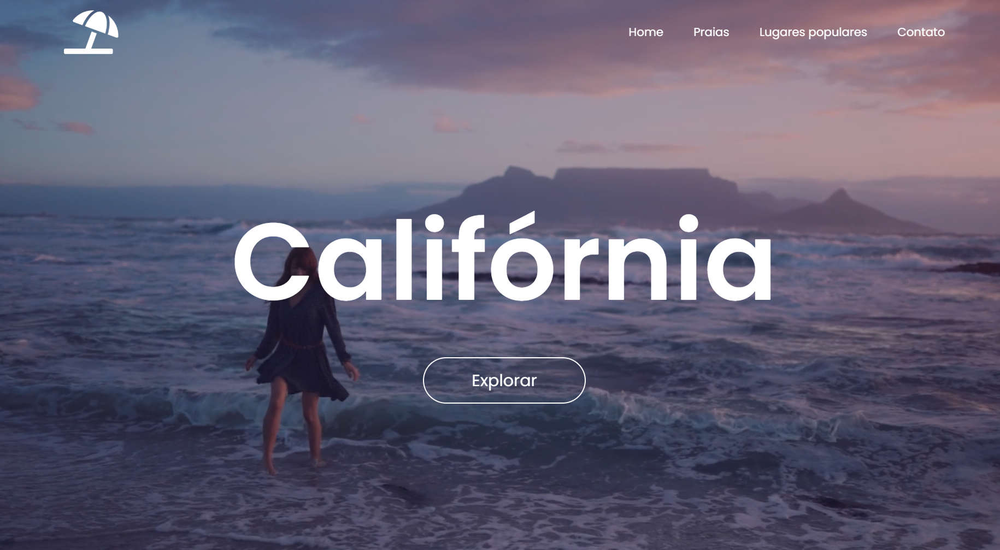

# 🌴 Califórnia — Landing Page com Vídeo de Fundo

Projeto de uma landing page turística sobre a Califórnia, desenvolvido com **HTML5 e CSS3** como parte de uma atividade prática do curso PROA.

O projeto tem como objetivo explorar a criação de interfaces modernas e imersivas, utilizando vídeos de fundo, efeitos visuais, animações de hover e técnicas de responsividade para proporcionar uma experiência visual atrativa ao usuário.

## 🖥️ Prévia do projeto

  

🔗 **[Acesse o projeto online](https://gabrielc0liveira.github.io/Projeto29Proa-SitedeEstadosEstrangeiros/)**

## Funcionalidades e características

- Landing page turística com temática da Califórnia.
- Vídeo de fundo reproduzido automaticamente e em loop.
- Cabeçalho com logotipo e menu de navegação horizontal.
- Título centralizado com efeito de contorno ao passar o mouse.
- Botão "Explorar" com bordas arredondadas.
- Camada de gradiente sobre o vídeo para melhorar a legibilidade.
- Ajuste das dimensões do vídeo conforme a proporção da tela.

## Tecnologias utilizadas

- **HTML5:** estruturação da página, navegação e integração do vídeo.
- **CSS3:** estilização, posicionamento, efeitos visuais e responsividade.
- **HTML Video:** reprodução automática e contínua do vídeo de fundo.
- **Media Queries:** adaptação do vídeo para diferentes proporções de tela.
- **Google Fonts:** utilização da fonte Poppins.

## Aprendizados

Durante o desenvolvimento, foram praticados conceitos como:

- Estruturação de uma landing page utilizando HTML e CSS.
- Integração de vídeos com a tag `<video>` e o elemento `<source>`.
- Configuração de reprodução com `autoplay`, `loop` e `muted`.
- Organização de elementos utilizando Flexbox e posicionamento absoluto.
- Aplicação de gradientes com `linear-gradient`.
- Criação de efeitos de hover com `-webkit-text-stroke` e `transition`.
- Utilização de Media Queries com `min-aspect-ratio` e `max-aspect-ratio` para ajustar o vídeo.

## 📂 Como executar o projeto

🔗 **[Acesse o projeto online](https://gabrielc0liveira.github.io/Projeto29Proa-SitedeEstadosEstrangeiros/)**

---

Desenvolvido por **Gabriel Oliveira** como parte das atividades práticas do PROA.
